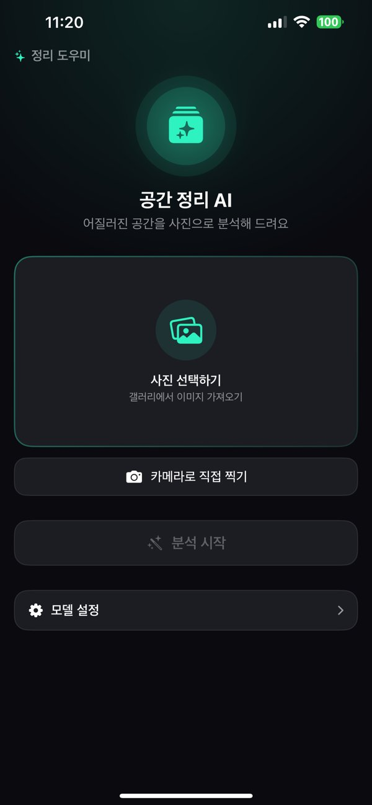
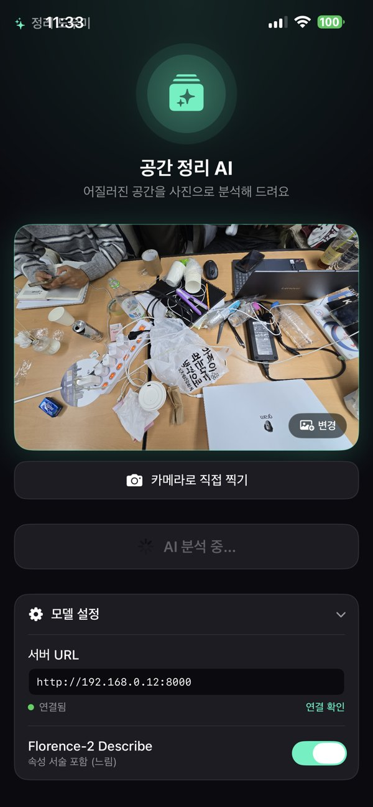
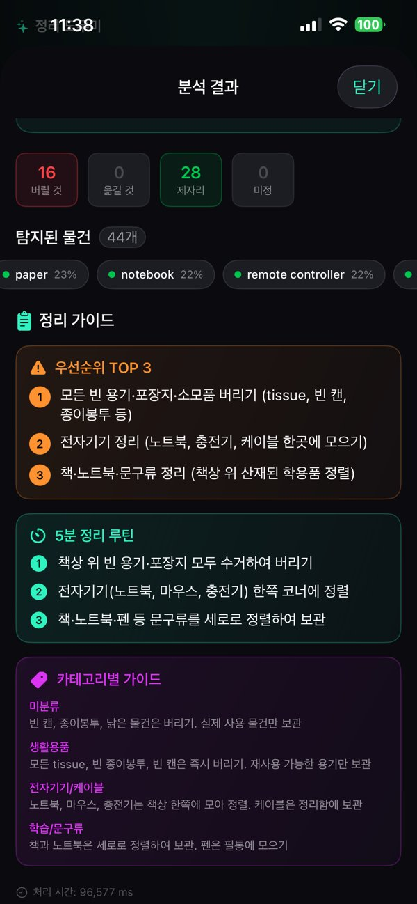
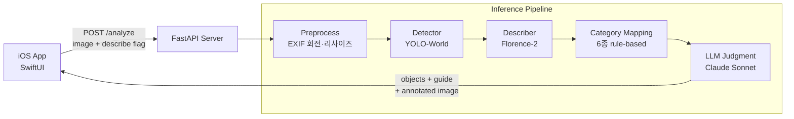

<div align="center">

# Cleaning Guide

**Open-Vocabulary Detection 기반 실내 정리 가이드**

어질러진 공간을 사진 한 장으로 찍으면 물건을 탐지·서술하고,<br>
LLM이 물건마다 _"버릴 것 / 옮길 것 / 제자리"_ 를 판단해 정리 가이드를 만들어 줍니다.

<br>


<br>


<br><br>





<sub>메인 화면 · 사진 등록 및 서버 연결 · 정리 가이드 결과</sub>

</div>

<br>

## Overview

| | |
|---|---|
| **기간** | 2026년 1학기 · 숭실대학교 컴퓨터비전 팀 프로젝트 (5팀) |
| **팀원** | 2인 · [민수빈](https://github.com/userbiin), [최다연](https://github.com/Choedayeon) |
| **한 줄 요약** | Open-vocabulary detector(YOLO-World) + Florence-2 속성 서술 + LLM 정리 판단을 하나의 파이프라인으로 묶고, 어질러진 책상 도메인에서 **탐지기 선정·실패 분석·성능 개선**을 정량 검증 |

**왜 Open-Vocabulary인가?**
COCO 80 클래스 같은 closed-set 탐지기는 충전기·영수증·필기구 같은 생활 잡동사니를 다루지 못합니다. 사용자가 무엇을 찍을지 모르는 정리 앱 특성상, **텍스트 프롬프트로 클래스를 지정**할 수 있는 open-vocabulary 탐지를 채택했습니다.

<br>

## Features

- **사진 → 정리 가이드** — 촬영/갤러리 사진을 업로드하면 탐지 결과와 정리 가이드를 한 번에 반환
- **Open-vocabulary 탐지** — 약 48개 생활용품 클래스 taxonomy를 프롬프트로 지정, 동의어·오타는 `RAW_TO_CANONICAL`로 정규화
- **속성 서술 (Describe)** — Florence-2가 물건의 상태(비었음·구겨짐·내용물 유무 등)를 서술해 LLM 판단 근거로 제공 (앱에서 ON/OFF)
- **정리 판단** — 물건마다 `discard` / `relocate` / `keep` 부여 + 우선순위 TOP 3 · 5분 정리 루틴 · 카테고리별 가이드 생성
- **결과 시각화** — 판단별 색상(빨강/주황/초록) bbox를 그린 어노테이션 이미지 반환

<br>

## Architecture



| 단계 | 역할 | 비고 |
|---|---|---|
| Preprocess | EXIF 회전 보정, 리사이즈, HEIC 지원 | OpenCV · Pillow |
| Detect | bbox + label 산출 | 이후 모든 단계의 입력 → **프로젝트의 핵심 평가 대상** |
| Describe | bbox crop → `<MORE_DETAILED_CAPTION>` | 같은 컵이라도 "빈 컵"이면 버리고 "음료 남은 컵"이면 유지 |
| Category | 학습/문구, 전자기기·케이블, 식기·음식, 의류·잡화, 생활용품, 쓰레기·기타 | 규칙 기반 매핑 |
| LLM | 물건별 판단 + 근거 + 정리 가이드 (JSON) | 멀쩡한 물건을 버리라는 **비가역 오류에 가장 큰 비용**을 주는 평가 설계 |

**Infra** — 학습·대량 추론은 학교 **RTX 4090**, 개발·추론은 **MacBook Air M4 (MPS)**, 두 장비는 **Tailscale**로 연결. 디바이스는 `cuda → mps → cpu` 순으로 자동 선택.

<br>

## Models

| 모델 | 용도 | 선정 이유 |
|---|---|---|
| **YOLO-World** (`yolov8s-world`) | 메인 Detector | 3개 후보 중 mAP@0.5 최고 (0.245) · 실시간 |
| **Florence-2-base** | Describer + 앙상블 보조 탐지기 (DRC) | 단일 모델로 영역 캡셔닝·탐지 모두 가능, 정밀도 57.4%로 오탐 억제에 강함 |
| **Claude Sonnet** (Anthropic API) | 정리 판단·가이드 생성 | 구조화된 JSON 출력, 상태 서술을 반영한 판단 |
| YOLOE (`yoloe-11s`) | 비교 후보 | 재현율은 비슷하나 mAP 낮아 탈락 |

> **최종 구성: YOLO-World + Florence-DRC 앙상블** — Florence-2가 앙상블 보강과 정리 판단용 속성 서술을 겸합니다.

<br>

## Dataset

| 데이터셋 | 규모 | 용도 |
|---|---|---|
| **자체 구축 Messy Desk 평가셋** | 22장 · 객체 785개 · ~48 클래스 | 탐지기 비교·개선 검증용 **frozen test set** (직접 촬영 + Roboflow 라벨링, COCO 포맷) |
| Roboflow *Detecting Working Desk* | 약 3,124장 · 11 클래스 | Fine-tuning 학습셋 (책상 도메인) |
| LVIS (subset) | 클래스별 quota 샘플링 | Fine-tuning 학습셋 (long-tail·소형 객체 보완) |

- 평가셋은 **탐지 결과와 독립적으로 full-image 라벨링** → 모델이 놓친 물건도 분모에 포함되어 recall이 정확히 측정됨
- 라벨링·프롬프트·평가에 **동일 taxonomy** 적용, 예측과 정답 라벨이 일치해야 정탐으로 인정하는 **class-aware 평가**
- 공개 desk 셋 일부는 클래스가 2종뿐이고 소형 객체가 없어 도메인 불일치로 제외

<br>

## Results

### 1. 탐지기 선정 (Zero-shot, 자체 평가셋)

| Detector | mAP@0.5 | Recall | Precision | F1 |
|---|:---:|:---:|:---:|:---:|
| **YOLO-World** | **0.245** | 20.1% | 22.1% | 21.1% |
| YOLOE | 0.167 | 20.6% | 25.3% | 22.7% |
| Florence-DRC | 0.123 | 17.3% | **57.4%** | 26.6% |

### 2. 클래스별 실패 분석 (YOLO-World)

| 납작·밀집 잡동사니 | GT | Recall | | 크고 윤곽이 뚜렷한 전자기기 | GT | Recall |
|---|:---:|:---:|---|---|:---:|:---:|
| paper | 229 | 8.3% | | laptop | 8 | 100% |
| cable | 86 | 4.7% | | monitor | 17 | 94.1% |
| book | 85 | 17.6% | | keyboard | 8 | 87.5% |
| pen | 68 | 17.6% | | speaker | 15 | 86.7% |

- paper·cable·book·pen 4개 클래스가 **전체 GT의 약 60%, 미탐의 절반**을 차지
- small-object mAP@0.5 = **0.124** (전체의 절반 수준)
- 원인은 단순한 크기가 아니라 **경계 모호성 + 밀집·가림(occlusion)** 으로 분석

### 3. 학습 없는 성능 개선 실험

| 기법 | 결과 (YOLO-World 대비) | 판정 |
|---|---|:---:|
| **Florence-DRC 앙상블** (Union → NMS) | Recall **+4.1%p** (20.1→24.2%), Precision **+12.0%p** (22.1→34.1%), 오탐 **−191** | 채택 |
| SAHI 분할 추론 (512×512) | mAP −0.092, 오탐 184 → 614 | 기각 |
| 프롬프트 어휘 확장 | 어떤 conf에서도 F1 baseline 미달 (단, paper·cable·charger recall 부분 회복) | 기각 |

> **Insight** — 분할 추론과 어휘 확장이 모두 실패했다는 것은 이 도메인의 병목이 **해상도나 어휘가 아니라 납작·밀집 객체의 경계 모호성**에 있음을 의미합니다. 추론 단계 보정으로는 한계가 있고, **도메인 데이터 기반 표적 fine-tuning**이 필요합니다.

### 4. Fine-tuning (진행 중)

**공개 데이터셋 Zero-shot Recall (YOLO-World, fine-tune 기준선)**

| LVIS (500장) | COCO (500장) | Working Desk (105장) | **Merged val (976장)** |
|:---:|:---:|:---:|:---:|
| 25.2% | 39.3% | 42.5% | **42.4%** |
| 라벨 분열 영향 | 클래스 통합 후 | polygon 수정 후 | fine-tune 기준선 |

| 항목 | 설정 |
|---|---|
| Base | `yolov8s-world.pt` |
| Data | Working Desk + LVIS subset → **24개 통합 클래스**로 remap (`datasets/build_merged.py`) |
| Train | 50 epochs · imgsz 1280 · batch 8 · RTX 4090 |
| Augmentation | mosaic 1.0 · copy-paste 0.3 · mixup 0.1 · HSV · flip |
| Eval | Merged val(976장) + 자체 frozen test set에서 zero-shot 대비 Recall / mAP / 클래스별 Δ 비교 (`train_merged.py`) |

**Fine-tuning 결과**

| 지표 (Merged val) | Zero-shot | Fine-tuned | Δ |
|---|:---:|:---:|:---:|
| Recall | 42.4% |  |  |
| Precision |  |  |  |
| mAP@0.5 |  |  |  |

> **Limitation** — 평가셋이 22장 단일 도메인이라 클래스별 지표의 신뢰구간이 넓습니다. 평가 규모 확대와 IoU@0.3 recall 병기를 후속 과제로 둡니다.

<br>

## Project Structure

<details>
<summary>펼치기</summary>

```
.
├── app/                    # FastAPI 서버
│   ├── main.py             # POST /analyze, GET /health
│   ├── config.py           # 환경변수 (모델 경로, conf, Claude 모델)
│   └── schemas.py          # 응답 스키마
├── models/
│   ├── detector.py         # YOLO-World / YOLOE 래퍼, 클래스 taxonomy, 라벨 정규화
│   └── describer.py        # Florence-2 영역 캡셔닝
├── pipeline/
│   ├── orchestrator.py     # 전처리 → 탐지 → 서술 → 분류 → LLM
│   ├── attributes.py       # 서술문 → 상태 신호 파싱
│   ├── category.py         # 6개 정리 카테고리 매핑
│   └── llm.py              # 프롬프트 구성 · Claude 호출
├── eval/                   # 평가 하네스 (mAP, recall, 통계, GT 변환)
├── datasets/
│   └── build_merged.py     # Working Desk + LVIS 통합 학습셋 빌드
├── ios/                    # SwiftUI 앱 (촬영, 업로드, bbox 오버레이, 결과 화면)
├── detector_eval.py        # 탐지기 비교 · 앙상블 · SAHI · 어휘 확장 통합 평가
├── train_merged.py         # Fine-tuning + 전후 비교 평가
└── requirements.txt
```

</details>

<br>

## Getting Started

**1. 환경 설정**

```bash
pip install -r requirements.txt
```

```bash
# .env
ANTHROPIC_API_KEY=sk-ant-...      # 없으면 탐지·카테고리까지만 동작
MODEL_PATH=yolov8s-world.pt
DETECTOR=yolo-world               # yolo-world | yoloe
CONF=0.08
```

**2. 서버 실행**

```bash
uvicorn app.main:app --host 0.0.0.0 --port 8000
```

**3. iOS 앱** — `OrganizeDetector.xcodeproj`를 Xcode로 열어 실행 → 앱의 *모델 설정*에 서버 URL 입력 (예: `http://192.168.0.12:8000`)

**4. 평가 재현**

```bash
python detector_eval.py --detectors yolo-world yoloe florence-drc --conf 0.08 --iou 0.5
python datasets/build_merged.py && python train_merged.py   # fine-tuning (GPU 필요)
```

<br>

## References

- T. Cheng et al., *YOLO-World: Real-Time Open-Vocabulary Object Detection*, CVPR 2024
- A. Wang et al., *YOLOE: Real-Time Seeing Anything*, ICCV 2025
- B. Xiao et al., *Florence-2: Advancing a Unified Representation for a Variety of Vision Tasks*, CVPR 2024
- F. C. Akyon et al., *Slicing Aided Hyper Inference and Fine-Tuning for Small Object Detection*, ICIP 2022
